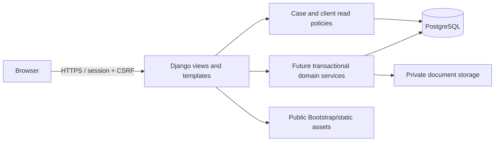

# Architecture baseline: Django monolith

Decision DEC-09, established 2026-11-09 from the team's chosen stack. One Django
process renders templates, validates input, runs domain logic, and accesses PostgreSQL.
There is no separate SPA, REST API, or Node build pipeline. Split those boundaries later
only if requirements demand it. Python 3.12 and Django 5.2 LTS are pinned with the
resolved dependency set in `uv.lock`; PostgreSQL 16.13 is the shared development/CI version.
Bootstrap 5.3.8 CSS is vendored locally with its license.

## Modules and ownership boundaries

| App | Responsibility / initial schema |
| --- | --- |
| `accounts` | Custom email-identity user, one explicit application role, sign-in/out, bootstrap and demo commands |
| `clients` | Client identity/contact information and record creator |
| `cases` | Case records, client links, team memberships, read selectors, initial list/detail pages |
| `documents` | Private storage adapter, document metadata and archive fields |
| `work` | Tasks with assignees/due dates; deadlines with date/type/status |
| `audit` | Actor/action/resource/result/correlation/timestamp event schema |
| `config` | URLs, middleware wiring, environment-specific settings, WSGI/ASGI entry points |

The custom user is installed before the first migration, avoiding a later identity
table swap. Email is normalized at creation/sign-in and has a database-backed
case-insensitive uniqueness constraint. The application role is distinct from Django
staff/superuser flags. Groups/model permissions may later describe coarse capabilities;
they cannot replace case-specific policy checks. Existing group permissions do not
grant access through the current selectors.

## Request and data flow

Views must begin with `cases.policies.cases_visible_to` or `clients_visible_to` for
record reads. Case detail lookup uses the filtered queryset, making nonexistent and
unassigned IDs both 404. Client access follows the backlog's unlinked/shared-client
rules; a shared client does not grant visibility into all its cases. Active administrators
have global read access. Django's session authentication rejects inactive users.

Upcoming feature work should place multi-record mutations in each app's `services.py`,
with server-side role/action checks, field validation, transactions, row locking or
optimistic concurrency checks, and audit writes. Templates never decide permissions.
This is a prescribed extension pattern, not a claim those mutation services already exist.

Relationships: Client ↔ Case is many-to-many; User ↔ Case is many-to-many; a Document,
Task, or Deadline belongs to exactly one Case. Tasks reference one assignee. Creator,
uploader, assignee, and audit-actor foreign keys protect referenced users from deletion.
Case-linked records use protected foreign keys. Lifecycle rules (minimum attorney,
closure blockers, archive behavior, and no hard-delete interfaces) still require the
backlog's service implementation; ordinary ORM access is trusted internal code.

Private document bytes live outside public/static directories with generated keys.
The storage adapter refuses `.url`, and there is no file-serving route. Later DOC-02
must authorize each download and set attachment headers; a future object-store adapter
must preserve that contract. Database/file backups must be coordinated because file
writes are not database transactions. The seed command cleans up newly written files
if its database transaction fails.

## Environment and validation boundaries

Development, tests, and deployment use separate settings modules sharing `base.py`.
All use PostgreSQL so tests exercise the same database behavior. Tests get a separate
database and temporary private files. Required secret/database values are read from
the environment without defaults; `.env` is a local management-command convenience.
Deployment never enables demo seeding or debug and requires explicit private storage,
hosts, and HTTPS origins. Test-only fast hashing must never be used in deployment.

Current tests cover email uniqueness/bootstrap, fixture repeatability, private files,
case/client visibility (including removal and inactive sessions), CSRF, session logout
replay, configuration failure modes, and a real Chromium workflow. GitHub and Jenkins
run the same format/lint/system/migration/test script. Exact versions and integrity
hashes are locked; security/dependency updates require review and rerunning checks.

## Current scope and remaining release work

This establishment step exposes only login, POST logout, case list, and read-only case
detail. It initializes all six domains and seeds their relationships. It does **not**
complete authentication throttling/absolute expiry, user administration safeguards,
write workflows/validation, file upload/download/archive UI, task/deadline transitions,
dashboard, audit capture/review/tamper protection, or release delivery. The backlog
criteria, including JSON-style failure codes, will be adapted to server-rendered forms
in a documented follow-up; currently anonymous browser requests redirect to sign-in,
invalid login redisplays a form, and missing CSRF is 403. Do not mark full stories done.

## Deployment boundary

The hosting operator must configure HTTPS termination, a WSGI/ASGI process manager,
static asset serving, a persistent private volume or private object store, restricted
database networking/TLS, host-specific trusted proxy handling, and backup/restore.
The secure settings are a starting point, not deployment completion. HSTS includes
subdomains/preload; confirm the chosen domain and all its subdomains support HTTPS
before deploying these defaults or adjust them through a reviewed hosting change.
Never expose `private-media/` in a reverse-proxy alias or public bucket.

Use a dedicated least-privilege deployment database role without `CREATEDB`. Migration
permissions and backups belong in the deployment runbook. Tests require a separate
local/CI role allowed to create disposable test databases. The local Compose role is
for developer convenience and must not be reused for hosting.

## Sources

- [Django 5.2 authentication](https://docs.djangoproject.com/en/5.2/topics/auth/default/)
- [Custom user model guidance](https://docs.djangoproject.com/en/5.2/topics/auth/customizing/#using-a-custom-user-model-when-starting-a-project)
- [Django deployment checklist](https://docs.djangoproject.com/en/5.2/howto/deployment/checklist/)
- [Django supported releases](https://www.djangoproject.com/download/)
- [Bootstrap distribution](https://getbootstrap.com/docs/5.3/getting-started/download/)
- [Playwright Python library](https://playwright.dev/python/docs/library)
