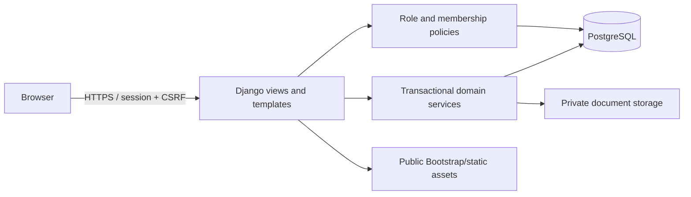

# Architecture baseline: Django monolith

Decision DEC-09, established 2026-11-09 from the team's chosen stack. One Django
process renders templates, validates input, runs domain logic, and accesses PostgreSQL.
There is no separate SPA, REST API, or Node build pipeline. Split those boundaries later
only if requirements demand it. Python 3.12 and Django 5.2 LTS are pinned with the
resolved dependency set in `uv.lock`; PostgreSQL 16.13 is the shared development/CI version.
Bootstrap 5.3.8 CSS is vendored locally with its license.
The [database design and ER diagram](database-design.md) supersede the initial schema
details below with explicit links, responsibility fields, revisions and aware due times.

## Modules and ownership boundaries

| App | Responsibility / initial schema |
| --- | --- |
| `accounts` | Custom email-identity user, sign-in/out, password change and recovery, session expiry, account administration |
| `clients` | Client identity/contact information and record creator |
| `cases` | Case records, client links, team memberships, authorization policies, case-scoped views and writes |
| `documents` | Private storage adapter, document metadata and archive fields |
| `work` | Tasks with assignees/priority/due times; deadlines with responsibility/completion details |
| `audit` | Append-only AuditEvent with actor/action/target/result/request/time and limited changed-field names |
| `config` | URLs, middleware wiring, environment-specific settings, WSGI/ASGI entry points |

The custom user is installed before the first migration, avoiding a later identity
table swap. Email is normalized at creation/sign-in and has a database-backed
case-insensitive uniqueness constraint. The application role is distinct from Django
staff/superuser flags. Optional capabilities use explicit user grants and are checked against the user's
application role. Case operations also require an active case membership.

## Request and data flow

Views use the filtered querysets in `cases.policies` for record reads. Case detail
lookup returns 404 for nonexistent and unassigned IDs. A linked client is visible
through an active link to an assigned case. Shared-client pages show only the
viewer's assigned cases. Active membership is required for administrators as well.
A client that has never been linked is private to its creator. Inactive historical
links do not restore intake access. Client search and duplicate warnings use the
same client scope as detail pages; all roles with client read access can search the
name, ID, email, and phone. Search terms and contact values are omitted from audit
events. Deployment access logs should omit query strings for authenticated routes.
Django's session authentication rejects inactive users.
Account deactivation also increments the account's session version, invalidating prior
sessions and recovery links after reactivation. PostgreSQL serializes sign-in attempts
per identity and account administration writes. Account changes and their audit events
commit in the same transaction.

Case mutations use server-side role and membership checks, scoped form fields,
transactions, row locking, and revision checks for updates. Templates use permission
decisions from the server to display available actions. Users can correct active
clients they can view. Attorneys and administrators can archive those clients and
add visible active clients to cases they are assigned to that are open or on hold.
Archive keeps every case link, hides the client from active lists and selectors,
and leaves history accessible under the same policy. The Archived list gives
authorized users a route back to those records.

Relationships: Client ↔ Case uses explicit CaseClient links; User ↔ Case uses explicit
CaseMembership rows with active flags and responsibilities. Case read policies require
active membership; authorized archived reads preserve access to history. A Document,
Task, or Deadline belongs to exactly one Case. Tasks reference one assignee. Creator,
uploader, assignee, and audit-actor foreign keys protect referenced users from deletion.
Case-linked records use protected foreign keys. Lifecycle rules (minimum attorney,
closure blockers, archive behavior, and no hard-delete interfaces) still require the
backlog's service implementation; ordinary ORM access is trusted internal code. Composite
PostgreSQL FKs prevent responsible attorneys/task assignees/deadline owners from referring
to another case's team. An atomic revision helper detects stale updates; all future
feature mutations must use that helper and authorized transactional services.

Private document bytes live outside public/static directories with generated keys.
The storage adapter refuses `.url`, and there is no file-serving route. Later DOC-02
must authorize each download and set attachment headers; a future object-store adapter
must preserve that contract. Database/file backups must be coordinated because file
writes are not database transactions. The seed command cleans up newly written files
if its database transaction fails.

## Environment and validation boundaries

Development, tests, and deployment use separate settings modules sharing `base.py`.
All use PostgreSQL so tests exercise the same database behavior. Tests get a separate
database and temporary private files. Required secret/database values are read from
the environment without defaults; `.env` is a local management-command convenience.
Deployment never enables demo seeding or debug and requires explicit private storage,
hosts, and HTTPS origins. Test-only fast hashing must never be used in deployment.

Current tests cover email uniqueness/bootstrap, fixture repeatability, private files,
case/client visibility (including removal and inactive sessions), CSRF, session logout
replay, configuration failure modes, and a real Chromium workflow. GitHub and Jenkins
run the same format/lint/system/migration/test script. Exact versions and integrity
hashes are locked; security/dependency updates require review and rerunning checks.

## Current scope and remaining release work

This establishment step exposes only login, POST logout, case list, and read-only case
detail. It initializes all six domains and seeds their relationships. It does **not**
complete authentication throttling/absolute expiry, user administration safeguards,
write workflows/validation, file upload/download/archive UI, task/deadline transitions,
dashboard, audit capture/review, or release delivery. PostgreSQL now rejects audit row
updates/deletes, but event collection and the review screen still need implementation. The backlog
criteria, including JSON-style failure codes, will be adapted to server-rendered forms
in a documented follow-up; currently anonymous browser requests redirect to sign-in,
invalid login redisplays a form, and missing CSRF is 403. Do not mark full stories done.

## Deployment boundary

The hosting operator must configure HTTPS termination, a WSGI/ASGI process manager,
static asset serving, a persistent private volume or private object store, restricted
database networking/TLS, host-specific trusted proxy handling, and backup/restore.
The secure settings are a starting point, not deployment completion. HSTS includes
subdomains/preload; confirm the chosen domain and all its subdomains support HTTPS
before deploying these defaults or adjust them through a reviewed hosting change.
Never expose `private-media/` in a reverse-proxy alias or public bucket.

Use a dedicated least-privilege deployment database role without `CREATEDB`. Migration
permissions and backups belong in the deployment runbook. Tests require a separate
local/CI role allowed to create disposable test databases. The local Compose role is
for developer convenience and must not be reused for hosting.

## Sources

- [Django 5.2 authentication](https://docs.djangoproject.com/en/5.2/topics/auth/default/)
- [Custom user model guidance](https://docs.djangoproject.com/en/5.2/topics/auth/customizing/#using-a-custom-user-model-when-starting-a-project)
- [Django deployment checklist](https://docs.djangoproject.com/en/5.2/howto/deployment/checklist/)
- [Django supported releases](https://www.djangoproject.com/download/)
- [Bootstrap distribution](https://getbootstrap.com/docs/5.3/getting-started/download/)
- [Playwright Python library](https://playwright.dev/python/docs/library)
