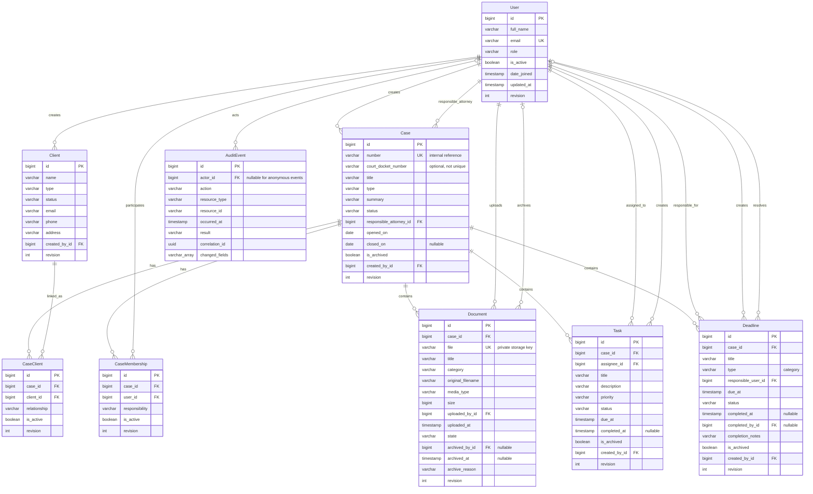

# LexFlow database design

Schema baseline: 2026-11-10. Implemented in the Django models and incremental migrations;
PostgreSQL is required. This document defines the schema before further feature screens.
Existing `0001` migrations are retained so deployed/local databases can upgrade without
recreating tables or discarding the fictional data.

## Entity relationship diagram

The explicit linking entities support many clients per case, many cases per client,
and per-case responsibilities for users. Every line ending at a child represents a
protected foreign key, including historical actor references. `AuditEvent` targets are
stable type/ID values rather than cascading foreign keys to every possible entity.



This diagram shows structural cardinality: a case may temporarily have no links while
its creation transaction is assembling them. A release-level create/close/reassign
service must enforce the business minimums and eligibility described below. The schema
also contains the timestamp and inherited authentication fields listed in the dictionary.

## Field dictionary and required values

All primary keys are generated `BigAutoField` values. Domain foreign keys use
`on_delete=PROTECT`; none of these relationships uses cascading deletion. Required
means SQL `NOT NULL`, with additional nonblank constraints where listed. A default
does not make a field nullable. Empty optional text is `""`, not SQL `NULL`.

All mutable domain entities, including users and link rows, have **revision** (positive
integer, default 1) and **updated_at** (aware datetime). Clients, cases, links, tasks and
deadlines also have **created_at**. Users use **date_joined** for creation and retain
Django's nullable **last_login**. Documents use **uploaded_at** for creation. Immutable
audit entries have only **occurred_at**, and no revision or edit timestamp.

| Entity / source | Required business fields | Optional fields, defaults, and limits |
| --- | --- | --- |
| [User](../accounts/models.py) | `full_name` ≤100, `email` ≤254, one `role`, `is_active`; password hash managed by Django | Roles `Administrator`, `Attorney`, `Staff` (default Staff); active defaults true. Retains Django password, staff/superuser flags, groups and model permissions. Account role is distinct from Django `is_staff`. |
| [Client](../clients/models.py) | `name` ≤150; `type`; `status`; `created_by → User` | Types `Individual`, `Organization`; statuses `Active`, `Archived` (default Active). Email ≤254, phone ≤30, address ≤500, notes ≤2,000 are optional. Names/contact emails are not unique: distinct clients may share them. |
| [Case](../cases/models.py) | `number` ≤40 (unique internal reference), `title` ≤200, `type`, `status`, `responsible_attorney → User`, `opened_on`, `created_by → User` | Docket number ≤100 and summary ≤2,000 optional. Types `Civil`, `Criminal`, `Family`, `Corporate`, `Other` (default Other); statuses `Open`, `On hold`, `Closed` (default Open). `opened_on` defaults to firm-local today; `closed_on` is nullable. `is_archived` defaults false. Internal number is case-sensitive and immutable by service convention; a future creation service generates it. Docket numbers may repeat across courts/cases and never act as record IDs. |
| [CaseClient](../cases/models.py) | `case → Case`, `client → Client`, `relationship`, `is_active` | Relationship `Client`, `Plaintiff`, `Defendant`, `Other` (default Client); active defaults true. One retained row per pair; deactivate/reactivate it instead of removing/recreating history. |
| [CaseMembership](../cases/models.py) | `case → Case`, `user → User`, `responsibility`, `is_active` | Responsibilities `Lead attorney`, `Attorney`, `Support` (default Support); active defaults true. One retained row per pair. Deactivation revokes read access without deleting attribution. |
| [Document](../documents/models.py) | `case → Case`, `title` ≤200, `category`, `file` ≤255 (unique private key), `original_filename` ≤255, `uploaded_by → User`, `uploaded_at`, `size`, `media_type` ≤100, `state` | Categories `Pleading`, `Evidence`, `Correspondence`, `Contract`, `Other`; state `Active`/`Archived` (default Active). Nullable `archived_by → User`, `archived_at`; optional `archive_reason` ≤500 until archived. Bytes are outside PostgreSQL; `file` is not a public URL. |
| [Task](../work/models.py) | `case → Case`, `title` ≤200, `assignee → User`, `priority`, `status`, `due_at`, `created_by → User` | Description ≤2,000 optional. Priority `Low`, `Normal`, `High` (default Normal); status `To do`, `In progress`, `Done` (default To do). `completed_at` nullable until Done; `is_archived` defaults false. |
| [Deadline](../work/models.py) | `case → Case`, `title` ≤200, `type` (category), `responsible_user → User`, `due_at`, `status`, `created_by → User` | Types `Hearing`, `Filing`, `Meeting`, `Other`; status `Pending`, `Completed`, `Cancelled` (default Pending). Notes ≤2,000 optional; nullable `completed_at`, `completed_by → User`; `completion_notes` ≤500 required on resolution/cancellation; `is_archived` defaults false. |
| [AuditEvent](../audit/models.py) | `action` ≤80, `resource_type` ≤40, `occurred_at`, `result`, `correlation_id` UUID | Nullable `actor → User` for anonymous events; `resource_id` ≤80 may be empty when no target exists. Results `success`, `failure`, `denied`. Multiple events may share a request/correlation ID. `changed_fields` defaults to an empty array, max 20 entries drawn from a fixed field-name allowlist; no before/after values, secrets or bodies. |

Email syntax, phone formatting, filename/content inspection, text trimming and maximum
input lengths still need form/service validation. `blank=False` is form validation,
not itself a SQL empty-string constraint. Critical display/identity fields, document
keys/filenames/media types, audit action/target type, and archive/completion reasons
have explicit checks rejecting empty/whitespace-only values. PostgreSQL varchar limits
also reject oversized scalar values. Not every optional contact field has a SQL format check.

## Database constraints and query indexes

- SQL PKs and all individual FKs reject missing parents. Every FK is protected in
  Django, with PostgreSQL referential checks backing it; raw SQL cannot silently
  cascade away linked records either.
- `User.email` has normal uniqueness plus `user_email_case_insensitive_unique` on
  `lower(email)`. Every stored role/status/type/category/priority/relationship enum is
  constrained in SQL, not merely a Django choices dropdown.
- `Case.number` is unique. `(CaseClient.case, client)` and `(CaseMembership.case, user)`
  are unique pairs, retaining the original tables' unique indexes. The conditional
  `one_active_lead_per_case` unique index permits **at most one** active lead.
- Composite keys `case_responsible_member_fk`, `task_case_assignee_fk`, and
  `deadline_case_responsible_fk` reference membership's unique `(case_id, user_id)` pair.
  A user from another case cannot be assigned through a raw ORM/SQL update. These FKs
  are **DEFERRABLE INITIALLY DEFERRED**: create the parent case and its membership in
  the same `transaction.atomic()` block; a missing membership fails at transaction
  commit. They do not imply the membership/user is active or an attorney.
- A closed case requires `closed_on`; other statuses require it NULL. Closing cannot
  predate opening. Case archive requires Closed. Task Done requires `completed_at`,
  and unfinished tasks require it NULL. Completed/cancelled deadlines require time,
  actor and nonblank completion notes; Pending requires those fields empty/NULL.
- Document storage keys are unique. Size must be 1–10,485,760 bytes inclusive. Active
  documents have no archive actor/time/reason; Archived requires all three. Bytes and
  archive metadata are retained. Content/signature validation remains DOC-01 work.
- `revision >= 1` applies to all mutable domain rows. Audit UPDATE/DELETE is rejected
  by a PostgreSQL trigger, including bulk ORM/SQL writes. Audit actor FKs are protected;
  deactivating a user retains their historical identity. The database owner can still
  perform privileged maintenance/drop triggers/TRUNCATE; deployment roles must not
  have those privileges. This is application-history protection, not an external ledger.

Every PK/unique constraint is indexed; Django also indexes ordinary FK columns. Added
indexes correspond to anticipated list and work queries:

| Table | Additional index columns / name | Intended query |
| --- | --- | --- |
| `clients_client` | `(status, name)` / `client_status_name_idx` | Active/archive list ordering; not a promise to accelerate arbitrary substring searches |
| `cases_case` | `(is_archived, status, opened_on)` / `case_worklist_idx`; `(court_docket_number)` / `case_docket_idx` | Case work lists and optional docket lookup |
| `cases_case_clients` | `(client_id, is_active)` / `caseclient_access_idx` | Client's active case links |
| `cases_case_members` | `(user_id, is_active, case_id)` / `membership_access_idx` | Authorized case scope |
| `documents_document` | `(case_id, state, category)` / `document_case_list_idx` | Case documents including explicit archive views |
| `work_task` | `(assignee_id, is_archived, status, due_at)` / `task_worklist_idx`; `(case_id, status)` / `task_case_status_idx` | Personal work and case completion checks |
| `work_deadline` | `(responsible_user_id, is_archived, status, due_at)` / `deadline_worklist_idx`; `(case_id, status, due_at)` / `deadline_case_dates_idx` | Responsible-user work and case date lists |
| `audit_auditevent` | `occurred_at`; `(actor_id, occurred_at)`; `(resource_type, resource_id, occurred_at)`; `(action, occurred_at)`; `correlation_id` | Date/actor/target/action filtering and request correlation |

## Authorization, archives and lifecycle

Archive/deactivate is the routine removal mechanism: User/CaseMembership/CaseClient use
`is_active`; Client uses status Archived; Case/Task/Deadline use `is_archived`; Document
uses state Archived with actor/time/reason. No feature exposes hard deletion. Archived
records and links remain stored and subject to exactly the same authorization policy.
An archive flag never grants access, and removing access never erases history.

`cases_visible_to` requires an active user and active case membership, or the active
Administrator role, and deliberately permits authorized historical/archived case reads.
`clients_visible_to` requires an active client link to a visible case, or creator/admin
access for a never-linked intake. Historical inactive links never restore creator access.
Future work lists should hide archives by default with an explicit authorized archive
view. Archived documents remain available for authorized historical retrieval through
the eventual download service, with fresh policy checks and audit events; private files
still have no public route today. This supersedes the earlier backlog's blanket ban on
archived downloads, in accordance with the database-design request.

The database enforces the row-local constraints and same-case relationships above.
Cross-row lifecycle rules still belong in authorized transactional services: active
Attorney eligibility, at least one active attorney/client at creation, matching the
lead responsibility to the responsible attorney, role-change/deactivation blockers,
closed-case write restrictions, one-way archives, completion transition permissions,
and closure blockers. Those services must lock affected rows, validate again, perform
the revision check, and append their audit event in one transaction. They are not
claimed implemented by this schema step. Document byte writes require separate cleanup
on database rollback; the seed command already does this for files it creates.

## Timestamps and conflicting edits

`USE_TZ=True`, PostgreSQL aware timestamps, and UTC database connections preserve an
instant consistently. Django templates/forms display the configured firm timezone,
currently `America/Los_Angeles`, with daylight-saving offsets. New task/deadline input
must include a local date **and time**; reject ambiguous/nonexistent local DST times at
the form boundary. `opened_on`/`closed_on` are deliberately date-only business dates.
Future dashboard overdue logic must compare `due_at < now`, with upcoming from now
through the end of firm-local day +7; a date earlier today may now be overdue.

[RevisionedModel.update_with_revision](../config/models.py) performs one atomic
`UPDATE ... WHERE id = ... AND revision = expected` and increments the revision. A
stale writer receives `ConcurrentEditError` and cannot overwrite the newer value.
Use the revision returned when a record was loaded; do not refresh it just before
writing. The helper authorizes nothing and does not call `full_clean`; a domain
service must validate/authorize first and use an atomic block for its related work.
Trusted migration/seed code and raw `.save()`/`.update()` can bypass this protocol;
feature mutation services must use it. Relation edits must revision-check their link
rows and lock/check the parent as appropriate. Django's operational `last_login` update
does not represent a user-profile edit and need not increment profile revision.

## Migration plan and reproducible checks

1. Accounts/clients/documents add revisions, fields, indexes and checks. Audit renames
   `Event → AuditEvent` without replacing records, then adds metadata and its immutable trigger.
2. Cases `0002_explicit_links` adopts existing join tables using model-state-only
   changes; the original columns/IDs/unique pairs already exist. Subsequent migrations
   add relationship/responsibility/status/revision fields and backfill the responsible
   attorney from the first active assigned Attorney (ordered by membership ID).
   Existing links and files are not deleted. A legacy case with no eligible attorney
   stops with its ID and must be repaired before retrying. Existing case open/closed
   dates derive from its recorded creation/update dates in the firm timezone.
3. Work migrations add nullable columns, backfill date-only values to **17:00
   America/Los_Angeles**, then require aware due timestamps and remove legacy columns.
   This is a documented conversion assumption, not an inferred court filing time.
   Review any non-demo legacy data before applying it. Historical completed task times
   use the existing update time if absent; historical resolved deadlines use their
   creator/update time with an explicit migration note because no original completion
   details existed. New deadlines default responsibility to the case's responsible attorney.
   Inconsistent old task memberships stop the migration rather than granting access.
4. Deferred composite membership FKs are added after both schemas/backfills exist.
   On reverse, old work dates are reconstructed in the firm timezone; time-of-day and
   new metadata cannot be represented by the old schema. Back up before downgrade.
   Run migrations with application writers stopped; the whole multi-app upgrade is
   not one global transaction even though each PostgreSQL migration is atomic.

From a configured checkout, with the dedicated PostgreSQL development service running:

```sh
uv run python manage.py migrate
uv run python manage.py seed_demo
uv run python manage.py seed_demo
sh scripts/check.sh
```

The shared check script includes [schema tests](../tests/test_schema.py) and an actual
[historical migration round-trip](../tests/test_migrations.py), as well as existing
foundation/browser checks. Tests migrate a fresh disposable PostgreSQL database,
reject raw invalid writes, verify indexes/constraints, exercise UTC/DST and stale
updates, reject audit edits/deletes, and verify original client/team links, file keys,
dates and audit IDs survive upgrade → downgrade → upgrade. Seeds use the explicit
links, responsible users, and aware due times. Migration tests never downgrade the
development database. Run only against a dedicated local/CI test database.

## Design sources

- [Django constraints](https://docs.djangoproject.com/en/5.2/ref/models/constraints/)
- [Migration database/state operations](https://docs.djangoproject.com/en/5.2/ref/migration-operations/#separatedatabaseandstate)
- [Django timezone handling](https://docs.djangoproject.com/en/5.2/topics/i18n/timezones/)
